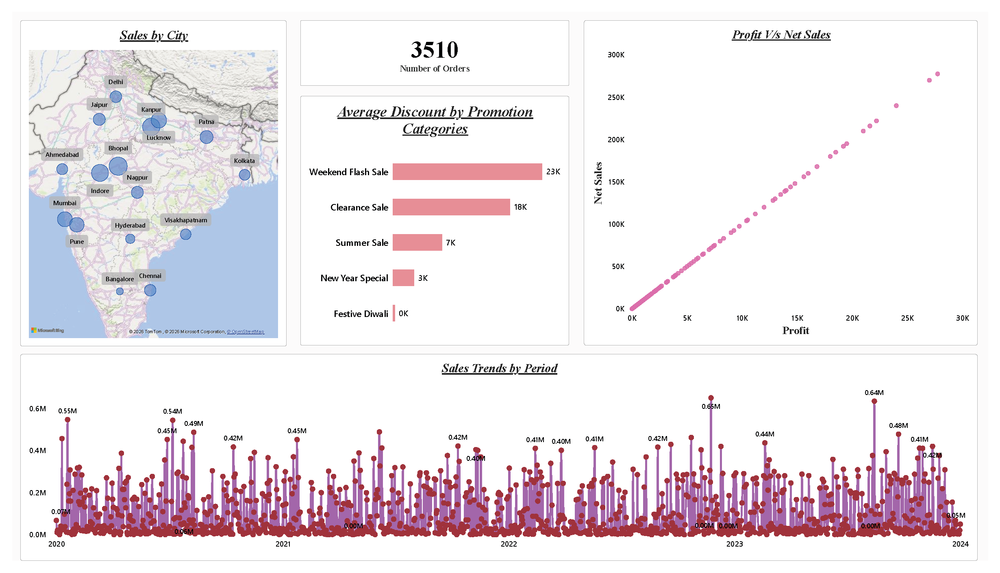

# ElectroHub Sales Analysis | Power BI

A retail sales analytics project built using Microsoft Power BI to analyse sales performance, product profitability, discounts, and sales trends.

## Project Overview

The project uses retail transaction data to explore business performance across products, customers, promotions, cities, and time periods through interactive Power BI reports.

## Business Objectives

- Identify the top and bottom 5 products by sales, profit, and quantity sold.
- Analyse daily, monthly, quarterly, and yearly sales trends.
- Examine the relationship between sales and profit.
- Compare sales, profit, and quantity sold across selected periods.
- Analyse average discounts by discount category.
- Calculate total orders and examine order-level performance.
- Analyse sales across different cities.

## Tools & Technologies

- Microsoft Power BI Desktop
- Power Query for data cleaning and transformation
- DAX for measures and calculations
- Data Modelling and Relationships
- Interactive Slicers, Filters, and Visualizations

## Dataset

The project uses publicly available retail sales data organised into four main tables:

- **Customers:** Customer and geographical details
- **Products:** Product names, categories, and prices
- **Promotions:** Promotion details and discount information
- **Transactions:** Order dates, quantities, sales, discounts, and net sales

## Dashboard Preview

## Analysis Highlights

- Product performance ranking by sales, profit, and quantity.
- Sales trends over different time periods.
- Sales and profitability analysis.
- Comparison between user-selected periods.
- Discount analysis across categories.
- Order-level details with interactive filtering.
- City-wise sales analysis.

## Project Files

- `ElectroHub_Sales_Analysis.pbix` — Power BI report
- `ElectroHub_Sales_Analysis.pdf` — PDF report
- `ElectroHub_Sales_Analysis_Source.zip` — Power BI Project source files
- `dashboard-overview.png` — Dashboard preview

## How to View

View the screenshots and PDF directly on GitHub. Download the PBIX file to explore the report in Power BI Desktop.
